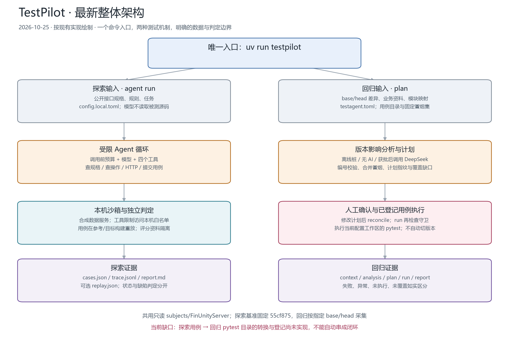
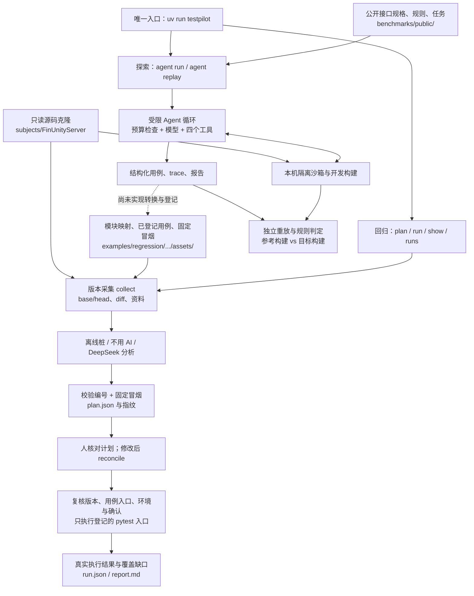
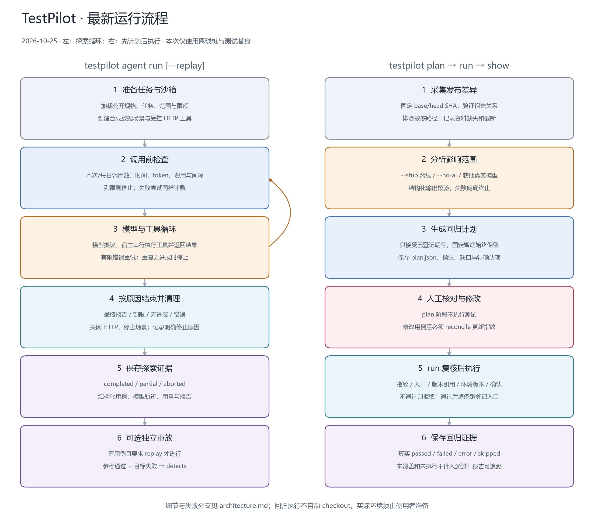
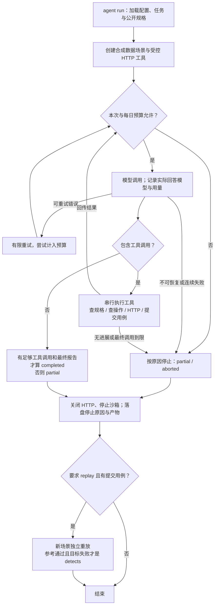
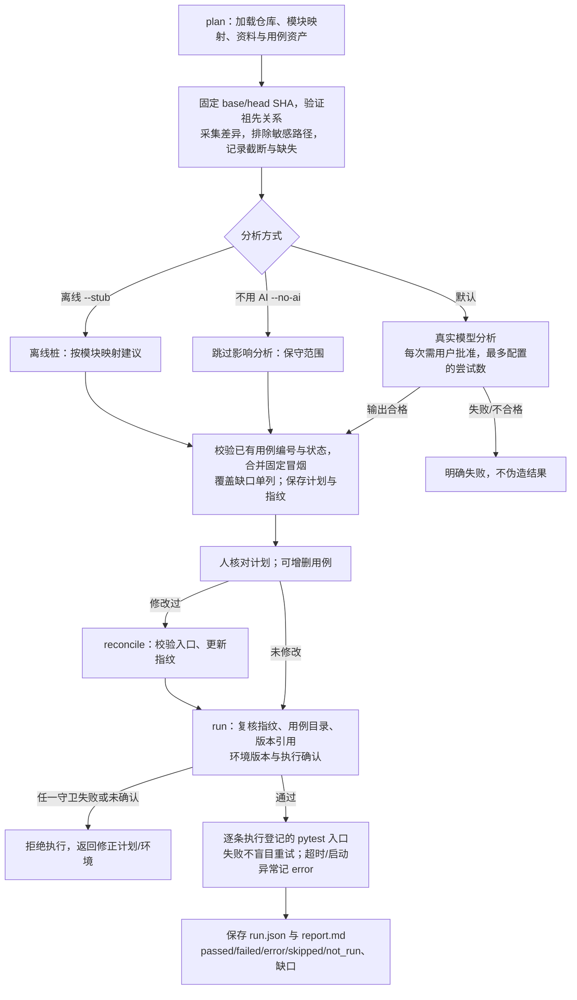

# TestPilot 最新架构与运行流程

维护日期：2026-10-25。按当前代码核对；对应统一入口 U0。实线为已实现的调用/数据关系，虚线标注未打通的用例衔接。模型调用能力已实现，不等于真实模型质量已通过验收；本次验证只使用离线桩与测试替身。

## 1. 整体架构

探索模型只读取公开规格、规则、任务和受控工具响应；源码、开发缺陷补丁、评分细节和宿主令牌不进入其上下文。回归分析读取版本差异、业务资料、模块映射和用例目录；真实调用时这些材料会发往配置的模型服务。两边的配置和产物仍各自管理，共用入口不代表执行机制已合为一个循环。

## 2. 统一操作入口

| 目的 | 命令 | 是否会调用模型 |
| --- | --- | --- |
| 查看全部命令 | `uv run testpilot --help` | 否 |
| 检查探索环境 | `uv run testpilot doctor` | 否 |
| 检查回归配置 | `uv run testpilot check --config <回归配置>` | 否 |
| 生成离线回归计划 | `uv run testpilot plan --config <回归配置> --base <base> --head <head> --stub` | 否 |
| 复核手工修改后的计划 | `uv run testpilot reconcile <run_id> --config <回归配置>` | 否 |
| 执行已确认回归计划 | `uv run testpilot run <run_id> --config <回归配置> --env-version <版本>` | 否；会执行用例 |
| 查看回归报告/历史 | `uv run testpilot show <run_id> --config <回归配置>` / `runs` | 否 |
| 探索一个任务 | `uv run testpilot agent run --task <任务> --replay` | 是；本次未执行 |

探索默认读取当前目录的 `config.local.toml`；回归默认在当前目录寻找 `testagent.toml`。回归可显式指定配置，命令前后都支持 `--config`；探索配置在主命令后、子命令前指定，例如 `testpilot --config <探索配置> doctor`。配置路径按各模块原有规则解析。旧 console 命令 `api-test-agent` 和 `testagent` 已移除；文件名 `testagent.toml` 保留，不需要改用户资产。

## 3. 两条运行流程

### 探索流程：有边界的工具调用循环

状态与结果分开：`completed` 表示运行流程完成，不表示发现了缺陷；`detects` 表示一个用例在参考构建通过、目标构建失败。还有 `fails_on_reference`、`no_difference`、`error` 等判定。循环不自行恢复到未来运行，也没有长期记忆或工作流引擎。

### 回归流程：先计划、后确认执行

`plan` 不执行测试；`run --dry-run` 只解析命令，结果为跳过；非交互执行必须显式 `--skip-confirm`。缺口和未执行项不会计入通过数。`run` 使用配置仓库的当前工作区运行 pytest，**不会自动 checkout 到计划 head**；`--env-version` 是用户提供的确认信息，没有自动证明部署/工作区与 head 一致。执行历史版本用例前仍需人准备正确的环境。

## 4. 状态、模块与证据边界

| 区域 | 核心实现 | 输入 → 输出 / 边界 |
| --- | --- | --- |
| 统一入口 | `src/api_test_agent/cli.py`；回归 `register_commands/execute` | 解析命令后分发；回归不加载探索配置 |
| 探索运行 | `runner.py`、`model.py`、`budget.py`、`tools.py` | 公开规格与受控响应 → cases/trace/report；调用前预算限制 |
| 受控执行 | `sandbox.py`、`targethttp.py`、`layout.py` | 克隆固定提交 → 本机合成数据服务；令牌由宿主注入 |
| 独立判定 | `replay.py`、`cases.py`、`expr.py`、`conformance.py`、`oracle.py` | 用例与真实响应 → 重放标签/规则结论；评分资料不给模型 |
| 回归采集与分析 | `regression/project.py`、`collect.py`、`analyze.py` | base/head、资料与映射 → context/analysis；字符预算不等于金额预算 |
| 回归计划与执行 | `regression/plan.py`、`runner.py`、`report.py`、`store.py` | 指纹化计划 → pytest 结果、覆盖缺口与报告 |
| 探索状态 | `runner.RunOutcome`、`artifacts/runs/<id>/` | completed/partial/aborted 与停止原因；模型原始产出不能代替独立判定 |
| 回归状态 | `regression.models`、示例配置的 `artifacts/<id>/` | planned/running/completed/aborted/incomplete；状态不等于所有用例通过 |

## 5. 分析时需要关注的当前缺口

1. **用例桥接尚未实现。** 探索输出的是结构化 HTTP 用例；回归目录登记的是 pytest 入口，需要人工评审、转换、登记，当前没有自动导入链路。
2. **回归环境一致性仍依赖准备。** SHA、指纹和环境版本守卫已实现，但没有自动构建/切换目标版本或验证部署身份。
3. **两套资产与配置仍然存在。** 已统一入口；探索的规则/任务和回归的模块映射/用例目录尚未统一为同一资产模型。
4. **质量证据仍有限。** 探索真实模型未验收；回归 2026-10-22 的真实运行是搬迁的历史记录，R1 的人工对照评测仍待进行。不要用离线桩通过率推断模型效果。
5. **回归模型缺少金额调用前守卫。** 当前只有字符预算与尝试次数限制，真实调用仍须逐次批准；统一入口没有改变这些预算边界。

两张 PNG 及 SVG 可由 `uv run --with matplotlib python docs/render_architecture.py` 重新生成；Matplotlib 只用于绘图，不加入运行依赖。历史 `docs/regression/` 配图只描述回归模块，本文件是当前整体架构正本。

## 2026-10-30：统一任务资产基础（F1）

唯一入口新增 task 子命令，模块为 tasks/models.py、store.py、cli.py。创建任务不再依赖旧探索配置或指定衡仓，允许空草稿；每个任务独立配置用户选择的目标与资料范围。统一来源、规则、接口、用例修订、审核和结果模型不自动桥接旧基准或回归；状态历史、不可覆盖修订和审核决定落盘。批准/执行与统计尚未接入，详见 task-assets.md；上文图中的原探索/回归链路不变，新完整工作流图仍为实施方案设计。

F2 首批（2026-10-30，进行中）：task discover 读取所选 Git 固定提交及指定文档目录，保存 inventory.json、来源哈希与离线清单；task materials 输出按实际序列化字符预算限制的模型材料。FastAPI 跨模块挂载仍待实现，局部发现标记 unresolved，不把离线清单当作真实路由全集。回归上下文现纳入最终请求、从 head 快照读取，并执行最终提示词预算裁剪；具体实测与限制见 acceptance.md。

2026-10-30 续做：F2 静态适配已补跨文件挂载图、本地引用、逐来源声明/差异、失败部分产物及中断重入；F3 新增 design.py/design_model.py，生成器只有资料输入和数据化用例输出，没有业务请求/批准工具。task design 保存实际请求/响应与调用元数据，task review 输出参数理由表和修订清单，草稿进入 pending_review。F4 批准与冻结、F5 执行和 F6 结果报告仍待接入；旧图不表示这些新流程已经完成。详见 task-assets.md 与 acceptance.md。
