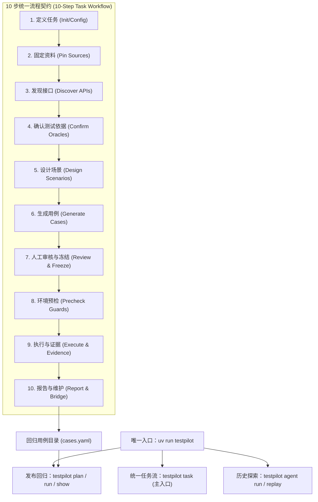

# TestPilot 最新架构与运行流程

维护日期：2026-11-04。按当前代码与实测核对。实线为已实现的调用/数据关系，虚线标注边界约束。

## 1. 业务现状与三条链路

当前 TestPilot 存在三条业务链路，以 **新任务流 (task)** 为全局统一主流程：

| 业务链路 | 核心定位与目的 | 主要特点与运行机制 | 状态与边界 |
|---|---|---|---|
| **统一任务流 (`testpilot task`)** | **主入口 / 主流程**：从资料发现接口、生成带依据用例、人工审核冻结后安全执行并对账报告 | 资料发现、数据化用例设计、人工审核冻结、四道执行前守卫、回环执行、证据对账与回归资产桥接各阶段严格分离 | **当前主入口**；已完成机制验收、执行前守卫修补、真实小闭环与 F8 资产桥接 |
| **发布回归流 (`testpilot plan/run`)** | **专门能力**：基于两次发布之间的版本差异智能推荐回归范围并执行 | 模型仅分析 Git diff 与资料给出建议（默认需 `--stub` 离线，调用商业模型需显式 `--allow-paid`），仅执行登记在 `cases.yaml` 的 pytest 入口 | **回归专用**；不自动生成新脚本，不改变被测仓库，支持与统一任务流双向资产复用 (F8) |
| **探索 Agent 流 (`testpilot agent run`)** | **专门能力**：在受控沙箱内由 Agent 探索接口寻找能重放的缺陷 | 模型可调用受控 HTTP 工具；参考构建与缺陷构建对照重放判定；日额度与单次预算严格硬限制 | **受控实验专用**；仅限获批的免费路由与固定沙箱，不作为日常业务主流程 |

---

## 2. 统一操作入口

| 模块 | 命令 | 目的 | 是否调用模型 | 风险与边界 |
| --- | --- | --- | --- | --- |
| **Task** | `uv run testpilot task create <id>` | 登记新测试任务（空草稿） | 否 | 仅写入元数据 |
| **Task** | `uv run testpilot task configure <id>` | 绑定目标仓库/提交/资料范围 | 否 | 离线记录，不访问网络 |
| **Task** | `uv run testpilot task discover <id>` | 静态解析 FastAPI/OpenAPI 声明 | 否 | 静态 AST/Spec 解析，不执行被测代码 |
| **Task** | `uv run testpilot task materials <id>` | 导出受字符预算限制的模型材料 | 否 | 严格按字符上限裁剪，无截断残缺 |
| **Task** | `uv run testpilot task design <id>` | 生成数据化测试用例（或导入离线响应） | 需参数配置 | 支持离线导入；商业模型调用前严格预算守卫 |
| **Task** | `uv run testpilot task review <id>` | 导出 Markdown 审核材料与参数理由表 | 否 | 纯离线生成审核文档，草稿置为 pending_review |
| **Task** | `uv run testpilot task approve <id>` | 人工决定并冻结本轮执行集合 | 否 | 冻结快照和执行器指纹，模型无权批准 |
| **Task** | `uv run testpilot task verify-approval <id>` | 复核冻结快照哈希完整性 | 否 | 检测用例或执行器是否被篡改 |
| **Task** | `uv run testpilot task execute <id>` | 执行冻结批准的用例集合 | 否（执行测试） | 执行前四道守卫；仅限 127.0.0.1；凭据自动脱敏 |
| **Task** | `uv run testpilot task report <id>` | 导出 Markdown 与 JSON 守恒报告 | 否 | 确定性对账公式核验；无落盘证据不得记通过 |
| **Task** | `uv run testpilot task export-regression <id>`| 导出批准用例至回归目录 cases.yaml | 否 | 自动写入 task_binding 绑定信息 |
| **Regression** | `uv run testpilot plan` | 分析代码差异生成回归计划 | 需用户批准 | 默认需 `--stub` 离线，调用商业模型需显式 `--allow-paid` |
| **Regression** | `uv run testpilot reconcile` | 复核人工修改后的回归计划 | 否 | 重新计算指纹 |
| **Regression** | `uv run testpilot run` | 执行回归计划中的已登记用例 | 否（执行测试） | 只执行已登记 pytest 入口，不修改被测仓库 |
| **Regression** | `uv run testpilot show / runs` | 查看回归测试报告与历史运行 | 否 | 只读展示 |
| **Explorer** | `uv run testpilot agent run` | 历史探索 Agent 工具调用循环 | 是 | 仅限 OpenRouter 免费额度，受控沙箱 |

---

## 3. 统一主流程：10 步流程契约（10-Step Workflow Contract）

### 3.1 核心分界与设计原则
在统一主流程中，系统严格落实三个核心分界与两个关键设计原则：

> [!IMPORTANT]
> **三个核心分界**：
> 1. **发现接口不等于理解业务规则**：从代码/文档提取出接口，不等于掌握了业务准则；实现观察不能自动升级为业务正确性判定标准。
> 2. **生成用例不等于批准执行**：模型生成的数据化用例仅是草稿，未经人工审核冻结严禁发起任何业务 HTTP 请求。
> 3. **收到响应不等于业务验证通过**：HTTP 200 不等于断言通过；测试通过必须由落盘证据支撑，缺失证据直接判定对账失败。

> [!NOTE]
> **两个关键设计原则**：
> 1. **测试依据独立于被测实现**：每条规则与断言必须显式标注其来源属性：已确认的业务要求 (`requirement`)、接口契约 (`contract`)、实现观察 (`implementation`)、待确认假设 (`hypothesis`)。实现观察可用于辅助生成用例，但不能直接作为判定产品缺陷的标准。
> 2. **环境版本严格区分“声明一致”与“实际验证一致”**：配置或审核快照中的 Git 提交仅代表“用户声明版本”；外部黑盒或实际回环运行环境若未经探针自检，只能标记为“未验证运行版本 (`version_verified=false`)”，报告中明确列出此项限制。

### 3.2 10 步流程契约全表

| 步骤 | 做什么 | 对应命令 | 输入 | 必须留下的结果 (输出) | 负责人 (Role) | 进入下一步的条件 / 拒绝条件 | 恢复方式 |
|---|---|---|---|---|---|---|---|
| **1. 定义任务** | 明确项目、范围、版本、目标环境与预算 | `task create` `task configure` `task validate-target` | 任务标识、项目名、目标提交、测试范围、环境标识 | `task.json` (状态: `created`) | 用户 / 测试工程师 | 范围与授权明确；**拒绝**：ID 重复、绝对/隐藏路径、生产环境标识 (`prod`) | 重新配置或 `task state <id> created` |
| **2. 固定资料** | 读取指定版本的源码、接口文档、业务规则 | `task discover` (前置采集) | 目标 Git 只读提交、指定文档目录 | 采集资料快照、`inventory.json` 来源清单与 SHA256 哈希 | 宿主系统 (只读适配器) | 资料可追溯，缺失显式记录；**拒绝**：文件超限、凭据文件混入 | 修正资料路径并重新执行 |
| **3. 发现接口** | 提取 method、path、参数、响应、鉴权与关联信息 | `task discover` | 源码 AST (FastAPI) 与 OpenAPI/Swagger 规范 | 接口清单、冲突项与未解析声明 (`discovery/<attempt>/`) | 静态解析适配器 | 每个接口有明确状态；**拒绝**：YAML/JSON 键重复、无法解析语法 | 修正文档或代码语法后重新发现 (生成新 attempt) |
| **4. 确认测试依据** | 区分文档规定、业务确认、代码观察和模型推测 | `task review` (规则准备) | `inventory.json` 中的声明与规则文件 | 规则清单及其确认状态 (`rules/`) | 测试工程师 / 架构师 | 推测不能直接作为缺陷标准；**拒绝**：未标记来源的伪需求 | 明确规则类别并标注确认状态 |
| **5. 设计场景** | 为接口选择正常、异常、边界、权限及状态关联场景 | `task design` (矩阵构建) | 接口清单、7 类场景矩阵规范 | 场景矩阵及不适用理由 (`scenarios.json`) | 测试设计员 / 宿主矩阵生成器 | 清楚哪些已设计、哪些仍缺；**拒绝**：矩阵场景与接口定义不匹配 | 补全场景映射或显式记录排除原因 |
| **6. 生成用例** | 写明前置条件、数据、步骤、断言、清理与参数理由 | `task design` `task design-recover` | 场景矩阵、字符材料、可选模型配置 | 带修订号的结构化用例 (`cases/<id>/<rev>.json`)、调用元数据 | 生成模型 / 测试设计员 (数据化输出) | 引用、步骤和断言通过静态校验；**拒绝**：缺参数理由、非法引用、商业模型单次费用 > 0.15 USD | 离线 `--response` 导入；`task design-recover` 恢复草稿 |
| **7. 人工审核与冻结** | 审核规则、用例、目标及允许的操作，冻结执行快照 | `task review` `task approve` `task verify-approval` | `review.md`、人工决定清单 (`decisions.json`)、执行配置 | `approval.json`、`approval.sha256` (状态: `ready`) | 人工审核员 (**严禁模型自审**) | 批准内容与实际执行内容一致；**拒绝**：未审用例漏网、指纹不匹配、模型尝试调用 approve | 审核员修正 `decisions.json` 后重新执行 `task approve` |
| **8. 环境预检** | 核对运行版本、账号、隔离、数据和预算 | `task execute` (前置守卫) | `approval.json`、`ExecutionConfig` | 环境校验记录、执行器兼容检查 | 执行引擎 (宿主守卫) | 实际环境满足批准条件；**拒绝**：生产环境 (`prod`)、环境不匹配、未知执行类型 (`execution_kind`) | 调整执行配置或纠正被测服务环境 |
| **9. 执行与收集证据** | 确定性执行；记录请求、响应、断言和异常 | `task execute` | 批准快照、受控被测服务 (127.0.0.1) | 每次执行独立的证据链 (`evidence/`、`events.jsonl`) | 执行引擎 (宿主) | 严格遵守请求上限与回环地址；敏感凭据自动脱敏；中断保存 `incomplete` | 修复环境后使用 `--approval` 续跑未执行用例 |
| **10. 报告与维护** | 对账结果、说明覆盖缺口，修订后重新审核，复用回归 | `task report` `task export-regression` | `execution.json`、落盘证据记录、回归目录 | 守恒报告 (`report.md`)、更新后的 `cases.yaml` (带 `task_binding`) | 报告引擎 / 资产维护工程师 | 结果可解释、可复核、可重放；对账公式守恒；**拒绝**：凭据缺失却声称 passed | 补齐证据重新生成报告；修正 `--approval` 重新导出 |

---

## 4. 能力边界三级对照表（Capability Boundary Matrix）

为了消除概念混淆，TestPilot 对核心能力建立严格的三级实现状态划分：
- **字段支持 (Field Support)**：数据模型 (Pydantic / Config) 已定义相关字段，允许输入和序列化，但底层机制可能尚未完全打通。
- **机制支持 (Mechanism Support)**：系统已实现相应的处理管道、抽象接口、校验器或适配机制，具备单元测试验证，但尚未在全量复杂场景下进行最终业务闭环。
- **真实验收 (Empirically Verified)**：已在真实运行环境（非单纯 mock/离线桩）下完成全链路闭环，产物经严格核对。

| 能力领域 | 字段支持 | 机制支持 | 真实验收 | 现状说明与未验证边界 |
| --- | :---: | :---: | :---: | --- |
| **单项目/单仓库测试** | **已支持** | **已支持** | **合成服务验收** | 在回环环境基于真实 HTTP 合成服务完成 10 步端到端小闭环验证（合成资料 → 导入设计 → 审核冻结 → 探针环境预检 → HTTP 执行 → 报告与桥接）；衡仓 (FinUnityServer) 55cf875 沙箱副本完成机制与探索验收。**未经验收真实模型设计质量、未验证复杂生产业务、未验证真人实际审核效果**。 |
| **多仓库联动 (Multi-Repo)** | **已支持** | **机制支持** | **未真实验收** | `ProjectConfig.repository`、`task.target_project`、`version_manifest` 及来源路径支持不同项目与相对根。但**尚未验收跨仓库依赖解析、多仓库协同提交触发与多服务联合编排**。审核仍核对单个 target_commit，当前严禁声称支持复杂多微服务跨仓库自动测试。 |
| **多执行器 (Multi-Runner)** | **已支持** | **机制支持** | **部分已验收** | `runner.py` 内置 `RUNNER_REGISTRY` 与 `register_runner` 机制，`CaseRevision.execution_kind` 字段支持拓展。**已实现并真实验收单进程 pytest 与统一任务 loopback HTTP 发包**；F8 回归桥接已打通回归执行器直接调度统一任务用例（`task_command`，按 `--case-id` 离散执行）。外部 runner（如 Newman、Playwright runner）处于机制预留阶段，未做真实验收；统一任务执行端对未知类型直接拦截为 `blocked`。 |
| **UI 操作 (Web Console)** | **已支持** | **机制支持** | **未真实验收** | 提供 Web Console (`testpilot ui`) 作为**任务配置与资产查看工作台**（只读透视与状态探活）。已落地服务端严格防护（校验回环 Host、Origin 端口白名单、Sec-Fetch-Site 阻断跨站、强制 `X-TestPilot-Token` 凭据授权）。但**不支持任何浏览器端自动化驱动（如 Playwright/Selenium 端到端点击），POST /execute 接口已被执行前守卫显式封禁**。UI 仅用于人工透视与配置，绝不能当作“已真实验收 UI 自动化测试执行能力”。 |
| **付费商业模型接入** | **已支持** | **机制支持** | **受控真实验收** | 字段支持 `ModelConfig` 与费用预算；机制支持基于 Token 单价的最坏情况调用前费用预留守卫（`worst_case_cost`）与 `--allow-paid` 拦截。当前探索基准固定为免费路由；回归模块经用户逐次批准可调用 DeepSeek `deepseek-chat`。严禁未经批准的持续商业调用。 |

---

## 5. 执行前安全守卫（Pre-execution Guards）

为了防止任何非预期发包、生产破坏或失控费用，系统在各关键节点建立了四道强制执行前守卫：

### 5.1 环境身份与版本探针守卫 (Environment Identity & Version Probe Guard)
- **校验位置**：`approval.py` (`ExecutionConfig.environment`, `version_endpoint`, `require_version_verification`) 与 `execution.py` (`execute_task`)。
- **拦截规则**：
  1. `ExecutionConfig.environment` 严禁指定为包含 `prod`、`production`、`online` 等生产关键字的环境。违者直接在配置校验阶段抛出 `ValueError`。
  2. `execute_task` 在发包前核对 `exec_config.environment` 与 `task.environment`，若不一致直接抛出 `PermissionError` 拒绝启动。
  3. **运行服务版本探针核验**：执行前向配置的 `version_endpoint` 发起探针请求，核对实际运行服务的 Git 提交哈希是否与 `target_commit` 一致。若配置了 `require_version_verification=True` 且版本不匹配或探针失败，直接抛出 `ValueError` 终止执行；执行结果独立记录 `declared_commit`、`actual_commit` 与 `version_verified`，报告中以 GitHub-style Alert 明显警告未核验状态。

### 5.2 未知执行类型守卫 (Unknown Execution Kind Guard)
- **校验位置**：`execution.py` (`execute_task`)。
- **拦截规则**：
  1. 执行器仅接纳已实现的 `http` 和 `structured-http-v1` 执行类型。
  2. 遇到未支持的执行类型（例如未经适配的外部 runner 或未知脚本类型），执行引擎**拒绝伪造 HTTP 请求**，直接将该用例标记为 `blocked`，生成 `environment_issue` 审计事件，确保测试结果客观真实。

### 5.3 商业付费预算与最坏情况费用预留守卫 (Paid Model Budget & Cost Reservation Guard)
- **校验位置**：`design_model.py` (`generate_task_design_with_model`) 与 `regression/cli.py` (`plan`)。
- **拦截规则**：
  1. **调用前最坏情况费用预留**：内置基准价格表（如 DeepSeek、OpenRouter 等）并支持在 `BudgetSettings` 配置 `cost_per_million_input_tokens` 与 `cost_per_million_output_tokens`。在网络发包前，根据输入字符估算 token 上界及模型最大生成 token 上限，计算 `worst_case_cost`。若 `worst_case_cost > max_cost_usd`，在发包前抛出异常拦截；若调用外部商业模型且定价未知，直接拒绝发起调用，杜绝“配置了预算但调用超额”风险。
  2. 回归模块 `plan` 命令若未指定 `--stub` 或 `--no-ai`，必须显式传递 `--allow-paid` 或配置环境变量 `TESTPILOT_ALLOW_PAID_MODEL=1`，否则在发起模型调用前直接退出，保护用户资金安全。

### 5.4 UI 访问边界与服务端会话授权守卫 (UI Boundary & Mutation Auth Guard)
- **校验位置**：`ui/server.py` (`TaskDashboardHandler`)。
- **拦截规则**：
  1. **CORS 与同源防护**：移除任何通配符 `*` CORS 标头，仅信任回环地址（`127.0.0.1` / `localhost`）且 Origin 端口必须与当前服务端端口严格一致；阻断 `Sec-Fetch-Site: cross-site` 恶意跨站请求。
  2. **服务端变更鉴权**：服务器启动时生成高熵随机会话令牌 `auth_token`，挂载 GET `/api/auth/token` 并在页面中注入；所有修改类 POST 请求强制核验 `X-TestPilot-Token` 请求头，缺失或不符直接返回 `403 Forbidden`。
  3. **防路径穿越**：针对 `task_id` 实施严格的合法字符校验 (`^[A-Za-z0-9_.-]+$`)，任何含 `../`、`\` 的恶意路径均被拒绝。
  4. **只读访问限制**：UI 定位为“任务配置与资产查看控制台”。检测到尝试通过 Web API 触发 `POST /api/tasks/{task_id}/execute`，统一返回 `403 Forbidden`，强制要求执行必须由人工在受信终端显式触发。

---

## 6. 合成服务端到端小闭环与回归资产执行桥接 (Synthetic Closed Loop & F8 Bridge)

### 6.1 合成服务端到端小闭环验证 (Synthetic Service Integration Verification)
系统在真实回环服务上完成了从空测试集开始的端到端小闭环验证（参见 `tests/test_closed_loop.py`）：
1. **接口目标**：针对运行于 `127.0.0.1` 的真实 HTTP 账户服务（`POST /api/v1/accounts` 与 `GET /api/v1/accounts/{account_id}`）。
2. **闭环链路**：从创建任务、OpenAPI 接口发现、数据化用例设计（含清晰参数理由与引用）、导出人工审核材料、人工冻结批准、探针核验环境版本、执行真实 HTTP 发包与提取断言，到宿主凭据脱敏与最终 Markdown/JSON 守恒报告导出。
3. **闭环核对**：逐条核对输入参数、服务器响应、JSON 提取路径、断言判定与报告中的覆盖率指标，验证了整套体系在真实业务请求下的可靠性。
4. **明确边界**：本闭环测试验证的是“合成资料 → 导入设计 → 审核机制 → 探针预检 → HTTP 执行 → 报告对账”的机制链路畅通，**未经验收真实模型生成质量、未验证复杂生产业务、未验证真人实际审核效果**。

### 6.2 资产维护与回归接入 (F8 Regression Bridge)
- **命令**：`uv run testpilot task export-regression <task_id> [--catalog <path>] [--approval <approval_id>]`
- **功能**：将统一任务流中经人工审核、验证有效的用例导出并合并至回归用例集（默认 `cases.yaml`）。
- **粒度隔离与离散执行**：导出的 entry 为离散命令行参数列表，并带有 `--case-id <case_id>`（及必要的 `--root`），避免单用例条目重复执行整个任务用例集。
- **回归执行器接通**：`regression/runner.py` 注册了 `task_command` 适配器并注入 `RUNNER_REGISTRY["task"]`；`testpilot run` 执行到携带 `task_binding` 的用例时，自动调用统一任务执行器并解析退出码和测试结果，实现真正的回归复用。
- **数据保护**：读取已有 `cases.yaml` 出现解析错误或损坏时抛出 `ValueError`，拒绝覆写已有资产。
