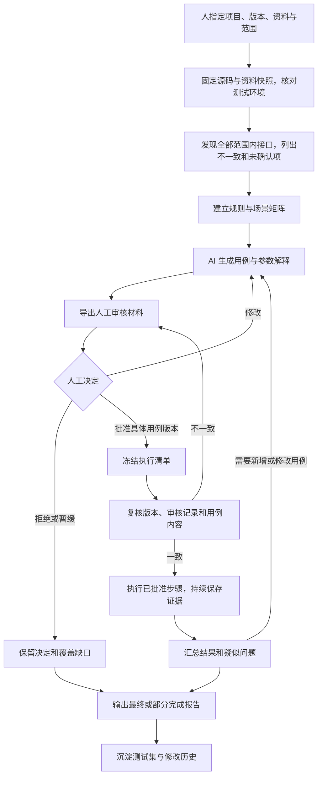

# TestPilot：从零建设接口测试集的实施方案

日期：2026-10-29。状态更新（2026-10-30）：**用户要求按方案开始执行，F1/F2 首版机制验收通过，F3 实施中，F4–F8 待实施**。后文待审/未实施表述保留方案编制时历史语境；当前进展以 TASKS.md、acceptance.md 与 task-assets.md 为准。

本文记录本次讨论确认的目标，并提出可分步实施的方案。它不替代当前架构正本，也不表示新增能力已经实现。方案编制不调用模型、不访问新的被测项目、不执行其接口。

## 1. 要交付的结果

人指定项目、版本、资料和测试范围。即使被测系统没有任何测试用例，TestPilot 也能梳理接口、整理测试依据、生成有解释的用例，供人审核；只执行审核通过的具体用例版本，保存执行事实并生成完整报告。人工与 AI 用例进入同一资产目录，由 AI 提议维护，人审核执行。

本轮已确认的要求：

- 同时发现缺陷和积累正常、异常、边界等测试用例，不能只保存缺陷复现。
- 输入支持人工资料、接口文档，以及用户允许读取的指定版本源码。
- 人控制测试版本；程序记录并核实实际目标，不自行选择最新版。
- 每条用例说明场景、依据、每个参数的选择理由、预期和断言。
- AI 生成用例后必须先由人查看并确认，才可执行；新增和实质修改也需重新确认。
- 执行结果来自工具和执行器，模型不能自行填写通过记录。
- 全部结束和中途结束都要有报告，列出通过、失败、异常、阻塞、跳过、未执行及覆盖缺口。
- 费用优化暂不列入本轮工作包；这不等于本次已发生或自动批准任何真实模型调用。

首轮验收证明“从零设计、审核后真实执行、结果可核对”，不预设一定找到真实缺陷，不承诺发现全部缺陷。

## 2. 首版范围和分批方式

先梳理本次项目约定范围内的全部接口，固定清单后分批生成、审核和执行。先选约 5–10 个有代表性的接口打通闭环，再扩展到清单其余项；试点数量是建议，不是裁剪接口清单的理由。

首版优先支持 Windows、本机测试环境、HTTP REST、JSON 请求与响应，以及配置化账号别名。路径参数、查询参数、非秘密请求头和请求体纳入用例；令牌由宿主注入。

文件上传、流式接口、WebSocket、并发性能、外部付费依赖等先进入清单并标记支持情况；不把“暂不支持”计为覆盖。目标有这些接口时，需要选择追加适配工作包，或在验收范围中明确列出缺口。

只使用合成数据。生产项目用于真实代码和业务场景验收，执行地点为独立测试副本；不连接生产数据库，不复用真实账号、凭据或数据备份。

## 3. 用户实际经历的流程

设计阶段优先读取离线资料和源码快照。不得用“探索”“补数据”为名，在人工审核前偷偷执行 AI 生成的业务请求。需要的探测、数据准备、清理和复现步骤也要体现在审核材料中。

环境启动、固定种子初始化和只读就绪检查属于预先声明的宿主适配流程，单独记录，不冒充已执行测试用例。

## 4. 模块职责和需要保存的对象

复用 Python、Pydantic、HTTPX、现有表达式与重放机制、pytest 适配和本地文件存储。首版采用单进程编排，不增加工作流框架、向量库、Web 服务或多 Agent。

| 模块 | 输入与职责 | 保存的对象 |
| --- | --- | --- |
| 目标管理 | 解析人指定的版本、限定读取范围，准备只读快照，核对运行目标 | 任务、源码/资料清单、版本与环境记录 |
| 接口发现 | 解析接口规格与支持框架的路由声明，合并路径前缀并核对来源 | 接口清单、来源定位、差异和不确定项 |
| 依据整理 | 提取参数与业务规则，区分明确要求、实现观察和待确认假设 | 规则目录、来源及冲突 |
| 用例设计与维护 | 生成场景、参数解释、准备/主体/清理步骤，导入既有测试 | 统一用例目录及不可变修订 |
| 人工审核 | 展示和记录批准、拒绝、暂缓、修改意见，绑定完整修订 | 审核记录和批准清单 |
| 执行与证据 | 只读取批准快照，执行步骤和断言，记录错误与中断 | 执行事件、用例结果、请求响应或 pytest 明细 |
| 报告与覆盖 | 从执行记录计算统计，按接口和用例展示覆盖与缺口 | 人可读报告及机器可读汇总 |

关键对象拟统一为 Task、SourceRef、Operation、Rule、CaseRevision、ReviewDecision、ExecutionRecord、Issue、Report；名称属于设计提议。

工作区相对路径用于来源定位；宿主绝对路径、密钥、真实数据不进入模型材料。模型读取材料和实际执行使用不同接口，模型不能调用批准入口或写入权威结果。

## 5. 接口和规则怎样得到

### 5.1 接口清单

以“HTTP 方法 + 归一化完整路径”为基础标识，保留原始 operation_id、挂载前缀和来源。核对文档、OpenAPI 与指定版本路由代码中的新增、遗漏、重复、路径差异和认证差异。

首个代码适配器优先按已选目标框架实现；若继续使用现有衡仓对象，可从 FastAPI 开始。静态提取不能解析的动态路由标为待确认，不能凭模型一句“已发现全部”关闭清单。仅有文档时，报告明确“接口全集来自提供的文档，未与运行系统核对”。

接口状态至少包含：已确认、来源冲突、待确认、范围外、当前执行器不支持。接口清单应包含各项原因，不能悄悄丢弃。

### 5.2 测试依据

每条规则记录 source_id、固定版本、相对文件位置或文档章节，以及摘录摘要。资料未纳入 Git 时保存独立内容哈希。

- 明确文档约束和经人确认的规则可作为正式预期。
- 代码约束可支持参数设计和实现一致性检查，但必须标记为实现依据，不据此宣称业务需求已被证明。
- 文档与代码冲突时保留双方依据；依据不明的场景进入待确认列表，不编造状态码、错误码或业务限制。
- 生成器可以提出假设，人可在审核时明确确认；未经确认的假设不得产生正式缺陷结论。

## 6. 一条用例的最低要求

| 字段组 | 必填内容 |
| --- | --- |
| 身份与版本 | 稳定编号、修订号、名称、来源为人工/AI、关联接口、适用版本 |
| 目的和依据 | 验证目标、场景类别、规则与来源、依据是明确要求还是实现观察 |
| 前置条件 | 账号别名、数据关系、业务状态、准备步骤及依赖 |
| 输入设计 | 参数位置和值/引用/生成方式、每个参数的理由、目标参数或合法背景参数、对应依据 |
| 执行步骤 | 数据准备、测试主体、核对和清理，明确依赖与副作用 |
| 预期和断言 | 状态码、关键响应字段、必要的状态变化及各自依据，说明实际检查方式 |
| 审核与维护 | 修订内容摘要、审核状态、批准记录、替代关系 |

场景分类至少包含正常、必填/空值/类型/格式、边界、业务组合、认证权限、状态变化、幂等重复；仅为适用接口设计，其他类别注明不适用或条件不具备。

参数设计先建立有效基线，再针对目标条件修改；多字段组合场景明确说明共同约束。生成值保留约束、种子或可重放值；不依赖“碰巧存在的 ID”。缺失字段、null、空字符串、数字和字符串要保持区别。

以下为假设规格的设计示例，不代表现有被测项目规则：规格写明“数量为大于等于 1 的整数”。

| 参数 | 值/来源 | 角色与理由 |
| --- | --- | --- |
| 商品 ID | 本用例准备步骤创建的商品 ID | 合法背景参数，保证商品存在 |
| quantity | 0 | 目标参数，位于合法下界 1 之外，用来验证拒绝非法数量 |
| 地址 ID | 本用例合成用户拥有的有效地址 | 合法背景参数，排除地址权限对结果的干扰 |

该用例必须给出明确拒绝响应依据，并通过支持的查询断言没有创建订单。若没有错误码依据，则留待确认，不能自行填写。审核页应能看到这张参数表、完整步骤及预期。

统一资产允许 execution_kind 为结构化 HTTP 或已登记 pytest；新增 AI 用例首版优先使用结构化 HTTP，避免引入任意代码执行。现有 pytest 作为适配资产保留，后续可逐步迁移。生成器与人工导入读取同一目录并产生同一审核材料。

导入 pytest 时审核材料同时提供入口、对应脚本与必要 fixture/配置的版本定位，批准绑定其内容快照和执行参数，不能只冻结 node ID。被测仓库中的原测试保持只读；AI 的维护建议在 TestPilot 管理的资产中形成新修订，需要改脚本时放在受管测试目录并验证依赖与隔离，不原位修改被测源码或测试。

## 7. 人工审核是执行前置条件

用例修订状态：draft → pending_review → approved / rejected / deferred；新修订使旧修订对新任务失效，历史结果不覆盖。

审核界面首版使用 Markdown 摘要和结构化审核决定文件。人可以逐条或按明确列出的批次批准，不要求一次看完全部接口。批次中未批准的用例保留待审核状态。

批准记录绑定：任务编号、目标提交与已确认环境、完整用例修订哈希、规则/资料快照、执行器及关键配置版本、批准用例集合、审核时间和操作者记录。用例哈希覆盖参数解释、准备/主体/清理步骤、预期与断言，防止只校验测试入口而放过内容改变。

新增、改参数、改断言、改步骤、改数据生成约束或切换目标版本均需重新审核；仅筛选已有用例组成新任务，也要确认本次执行集合。清理和复现不能绕过审核。结果文件不属于可编辑用例定义。

批准操作只由人通过宿主命令发起，不提供为模型工具。现有 reconcile 只更新指纹，不视为批准；现有 --skip-confirm 不能代替新流程的审核记录。人工确认后可非交互执行已批准快照。

这项机制保障正常使用路径中的审核边界，不宣称能够防止拥有本机文件写权限的人蓄意伪造本地记录。

## 8. 执行、状态、失败和恢复

任务状态拟为 created、discovered、designed、awaiting_review、ready、running、completed、incomplete、blocked、aborted；明确记录每次转换原因。审核状态、执行结果、缺陷确认状态分别存储。

执行前检查目标版本与环境、批准快照、数据依赖和允许操作；任何关键内容不一致都拒绝沿用批准。人准备或选择版本，程序核对；首版本机目标通过只读快照运行，宿主记录该服务进程对应的源码快照和配置。外部部署无法证明身份时标记版本未核实，不出具已验证指定版本的结论。

每条用例：先持久化执行开始事件，再运行批准的准备、主体和断言，最后清理并写终态。宿主保存请求方法、路径、合成参数、脱敏响应、时间、断言表达式和结果；认证信息不落入模型材料或报告。

| 用例结果 | 含义 |
| --- | --- |
| passed | 测试主体和必需断言完成且通过；清理异常单独记录并在任务报告告警，不隐藏 |
| failed | 有明确依据的断言不满足，附预期与实际；不直接等同确认产品缺陷 |
| error | 执行、连接、解析、断言求值或准备步骤实际启动后发生异常 |
| blocked | 前置条件不满足，无法进入计划的测试流程，记录原因和证据 |
| skipped | 人明确不执行或条件规则明确跳过，记录决定 |
| not_run | 本轮冻结执行清单内尚未执行到，包括中断后剩余项 |

准备步骤实际失败和事先发现依赖不具备分别记录为 error 与 blocked，保留阶段信息。审核未批准、被拒绝和暂缓的条目不混入本轮冻结执行清单，另表统计。

任务 completed 仅表示冻结清单已形成终态且报告已保存，不表示全通过或全接口覆盖。尚有 not_run、运行中状态或证据未落盘则为 incomplete；系统级失败另记 aborted/blocked，仍输出部分报告。

持续落盘用于中断后的对账，不代表引入工作流恢复框架。恢复时不自动重试有副作用的中断步骤：保留“请求可能已生效、结果未知”，先核对状态或重置隔离场景，再决定新尝试；修改步骤需再次审核。每次尝试保留，不能覆盖首次失败。

pytest 适配保存 JUnit 或等效结构化结果，区分实际收集、通过、失败、跳过和异常。不能把进程退出码为 0 等同于所有登记测试通过；空收集、全部跳过和缺失明细不能伪装为真实通过。用例目录条数与 pytest 函数数分别展示。

## 9. 最终报告和覆盖口径

报告即使在模型失败、未审核、环境阻塞或人工中断时也可生成。由确定性程序计算状态和数字，模型摘要只能引用已存在的 evidence_id，不能创建权威执行结果。

报告包含：任务与版本、资料来源、接口清单、场景矩阵、用例审核决定、每例设计及参数理由、预期与实际、执行证据、问题与确认状态、清理失败、未覆盖和运行限制。

问题状态至少区分疑似产品缺陷、用例问题、环境问题、依据待确认及经核实的产品缺陷；复现情况和判定依据单列。没有发现真实缺陷也是有效结果，不能为满足验收凑缺陷数量。

统计分开计算：发现接口、范围内已确认接口、支持自动执行接口；生成/批准/执行用例；pytest 函数；请求与断言。有限的“接口×适用场景”矩阵用于跟踪缺口，不宣称穷尽所有输入组合。

本轮冻结执行清单的守恒关系：

`计划执行数 = passed + failed + error + blocked + skipped + not_run`

未批准、拒绝、暂缓和范围外另表统计。报告中的接口调用覆盖、场景设计覆盖和有证据的执行覆盖分别显示分子、分母及范围；一个接口只调用一次不等于充分测试。

模型编造“已通过”但没有执行记录时，报告不得增加通过数；证据缺失时标记未验证/记录不完整。执行证据证明观察到的行为，不证明需求本身正确，也不证明系统没有其他缺陷。

## 10. 工作包、依赖和验收

以下为提议任务，F1–F8 均未开始，需用户审阅本方案后再实施。工作包按串行依赖交付，每包有可演示结果，不以文件存在或测试数量作为唯一完成标准。

| ID | 工作包与具体交付 | 主要依赖 | 验收方式 |
| --- | --- | --- | --- |
| F0 | 本方案、任务与验收口径 | 本次讨论 | 用户可审阅目标流程、边界和工作包；方案编制不算功能验收 |
| F1 | 统一任务/规则/用例修订/审核/结果模型，设计状态机与旧资产适配边界 | 方案审阅 | 空目录可建任务；人工与 AI 样例可进入同一目录；版本、理由、依据、结果边界均可校验 |
| F2 | 指定版本快照、接口发现与规则来源，首个框架适配 | F1、确定目标项目和读取范围 | 与可核对的路由/文档清单逐项对账；挂载前缀、动态未解析、冲突、缺失和不支持项不丢失 |
| F3 | 场景矩阵、AI 用例生成、参数理由和审核材料导出 | F2 | 从零生成小批用例；每例能解释参数与预期；模型输出不合格或依据缺失进入明确状态；无业务测试请求 |
| F4 | 人工批准清单、修订冻结、执行前拒绝机制 | F1、F3 | 未批准不能执行；改参数/断言/准备/清理/目标版本后被拒；模型无批准工具；新用例再次进入审核 |
| F5 | 统一执行适配、合成数据依赖、逐步证据、中断对账、问题记录 | F4、目标环境适配 | 已批准正常/断言失败/执行异常/阻塞/中断路径有真实记录；不偷偷重试副作用；旧 pytest 结果可区分 skipped |
| F6 | 总报告、按接口/用例查看、覆盖统计及报告一致性校验 | F5 | 对账公式成立；成功失败和未跑完均可查看；无证据不计通过；中断也能输出报告 |
| F7 | 真实模型＋真实项目从零验收，扩展到全范围清单 | F2–F6、项目/版本/资料/环境明确、模型调用条件满足 | 空测试集开始，小批人工审核并实际执行；抽查证据与重放；全清单每项有覆盖状态与缺口；分批批准，不强求全通过 |
| F8 | AI 维护与回归接入 | F7 | 复用同一目录，旧例保留、更新有修订、新例重新审核；指定下一版本复跑，历史结果不被覆盖 |

建议交付顺序：F1 → F2 → F3 → F4，先交付可查看的审核材料；随后 F5 → F6，交付可运行的闭环；最后 F7 做真实验收，F8 接回日常回归。完整目标包含 F8，不以“暂时跑通”冒充统一维护已经完成。

F2 前先登记首个目标：本机仓库和提交、接口框架、资料位置、允许读取内容、启动方式、测试环境与合成身份准备方式、接口范围。现阶段不知道用户所指的生产项目是否就是衡仓，不能按目录存在推断。

目标明确后才估算 F2/F5 的适配工作量；不在未知接口数量、框架和环境条件时承诺固定工期。每包按可演示的验收结果推进。

## 11. 可复用实现和先修事项

| 当前实现 | 方案中的用法和需要改变的地方 |
| --- | --- |
| cases.py、expr.py、replay.py | 复用数据化步骤、响应引用和确定性断言；规则 ID、账号别名不再固定为衡仓集合，增加场景/依据/参数解释/修订；保留旧格式读取适配 |
| targethttp.py、sandbox.py、layout.py | 复用路由限制、宿主令牌、合成数据与受管目录；抽出目标项目启动和种子适配，不假设所有项目都用同一 SQLite/登录接口 |
| regression/project.py、collect.py、analyze.py | 复用项目配置、资料采集和结构化输出；增加整版接口发现与无用例生成入口，不依赖 base/head 才能启动 |
| regression/plan.py、cli.py | 复用计划落盘与执行前复核；当前入口指纹不足以证明用例内容被审核，须增加完整修订绑定；reconcile 和 --skip-confirm 不能充当批准 |
| regression/runner.py、report.py、store.py | 复用 pytest 执行和报告结构；增加结构化用例统一结果、JUnit 明细、持续事件与部分报告 |
| benchmarks/public、dev、现有测试 | 保留为原基准与兼容验证，不能作为新项目从零验收时的模型输入或隐藏的已有用例 |

源码阅读边界分开处理：原开发基准继续保持只读 public 材料的黑盒模式；新任务允许按人指定范围由宿主提取和筛选源码片段。不得因此把 subjects/ 整体开放给模型，或把缺陷补丁、评分与已有测试混入从零验收。

在相关工作包中修正本次已核对的实现缺口：

1. regression/collect.py 采集 context_files，但 analyze.py 当前请求组装未包含这些内容；F2 必须验证“被选中材料”和“实际发送材料”一致。
2. collect.py 的总上下文超限分支只追加说明，未实际裁剪；F2/F3 要以最终请求长度验证真实截断、来源保留及未发送记录。此为输入完整性控制，费用优化仍暂缓。
3. 现有探索 completed 判断主要依赖最终文本和工具次数，不能复用为新流程的完成验收；F5/F6 依据批准清单与真实执行状态判断。
4. 现有 pytest 适配主要按退出码判结果；F5 增加结构化明细，避免全跳过却标为通过。

## 12. 怎样证明没有虚假执行

开发验证先用可重复替身覆盖拒绝与失败路径；替身只验证程序机制，不作为真实模型效果证据。随后在实际模型和选定项目上做 F7。

| 验收项 | 必须看到的证据 |
| --- | --- |
| 零用例起步 | 输入无测试资产；保存接口清单、来源、生成用例和真实模型记录，不向模型暴露已有测试或开发缺陷答案 |
| 参数设计可解释 | 抽查全部试点用例：参数值/引用、角色、理由、来源、场景与预期一致 |
| 审核有效 | 未批准及批准后修改内容的执行被拒绝，实际业务请求数为 0 |
| 通过真实发生 | 宿主步骤与断言记录完整；抽样在新场景重放，输入和观察可核对 |
| 失败不伪装 | 已知可控的错误响应会产生 failed，网络/脚本问题产生 error，缺依赖产生 blocked |
| 模型不能造通过 | 给出虚构成功摘要但没有工具结果时，通过计数不变，报告标出缺证据 |
| 未跑完有报告 | 中断后剩余用例为 not_run，未知副作用有标记，统计与事件一致 |
| 没覆盖不隐瞒 | 所有清单项有状态；拒绝、暂缓、资料不明和不支持项均可查 |
| 维护可追踪 | 改动产生新修订和新审核；历史执行仍指向旧快照 |

通过、失败、异常等控制样例可由小型合成服务提供；它们只证明机制，不当成真实项目中发现缺陷的数字。真实项目没有自然出现全部状态时，不故意改坏目标源码凑结果。

“没有虚假执行”的验收边界是：模型无法经正常工具链伪造程序执行事实，用户能够抽查和复现；不宣称本机记录不可篡改或仅凭日志证明全系统正确。

## 13. 拟议操作入口与交付物

新增能力建议放在唯一入口的 task 子命令下，避免改变现有 run/plan 的含义。以下命令仅为设计，**当前不可直接使用**：

| 操作 | 拟议入口 |
| --- | --- |
| 登记任务、版本和资料 | testpilot task create |
| 梳理接口和依据 | testpilot task discover |
| 生成/更新待审核用例 | testpilot task design |
| 导出可查看审核材料 | testpilot task review |
| 人提交具体批准决定 | testpilot task approve |
| 执行冻结的批准清单 | testpilot task execute |
| 查看当前或最终报告 | testpilot task report |

每个任务至少交付目标记录、接口清单、规则目录、场景矩阵、用例目录及修订、人工审核材料与决定、执行事件与明细、问题清单、Markdown 报告与结构化汇总。任务准备失败时也保存已获得的信息及失败原因。

共享的需求说明与稳定验收记录放在 docs/；被测源码、私有片段、具体输入输出和运行证据保存在本机被忽略的任务产物中。PROJECT_STATUS 只引用稳定文档，不直接引用运行目录。

## 14. 本次交付和实施起点

本次只交付方案与项目内记录同步。没有新增命令、没有放开模型源码权限、没有执行真实模型或新的被测项目，也没有把 F1–F8 标成已完成。

方案审阅时重点确认：流程是否符合预期、首版支持范围、用例解释与报告是否足够、审核粒度是否合适。实施从 F1 的统一对象与状态边界开始；目标接入信息在 F2/F5 前落实。

## 2026-10-30 实施澄清

用户明确目标应当由自己选择，不在开发时写死，也不要求现在在聊天里确定首个真实项目。产品按任务登记项目、完整提交、资料和允许读取范围；可先创建未选目标的草稿，实际发现与执行前再校验。F2/F5 的通用适配开发可使用合成仓库/资料/服务，真实项目选择只约束具体运行与 F7 真实验收，不作为继续开发的前置输入。本澄清优先于前文“F2 前登记首个目标”的排期表述；现有衡仓黑盒边界不变。

F1 完成范围与未开放的批准/执行路径见 task-assets.md；实际机制验收记录见 acceptance.md。
