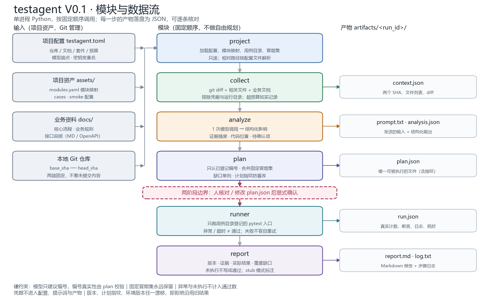

# TestPilot 回归模块（testagent）— 发布版本变更分析与回归建议（MVP V0.1）

来源方案：日常库 `output/20261022-测试Agent最小可行落地方案.md`（本机资料）。2026-10-25 并入的项目正式命名为 TestPilot（测试领航员），现有目录保留 `api-test-agent/`，回归模块为 `api_test_agent.regression` 子包：
给定上次发布提交与本次候选提交，解释改了什么、建议回归什么、指出哪里缺用例，并运行**已登记**的接口用例，产出可核对证据的报告。

首版为单进程 Python 程序，按固定顺序调用模块，不做自由规划循环，不引入数据库、队列或工作流引擎。

## 它做什么 / 不做什么

| 做 | 不做（首版明确排除） |
| --- | --- |
| 固定 base/head 两端的发布快照比较，保存完整 SHA | GitHub 登录 / App / Webhook / PR 回写 |
| 用模块映射 + 业务资料 + 用例目录生成结构化影响分析 | 向量 RAG、自动抓取全仓语义关系 |
| 只建议**已存在**的用例编号，程序再校验编号与入口 | 让模型生成系统命令或直接跑测试 |
| 固定冒烟集始终保留，人工确认后才执行 | 审批系统、自动重试带副作用的失败用例 |
| 真实执行 pytest 入口，保存计数/断言/日志/耗时 | 自动改断言、自动修复脚本、UI/性能执行 |
| 报告列出未覆盖项并**不计入通过数** | 多项目、多任务并发、Web 界面 |

## 架构图

- [模块与数据流](architecture.png)：输入 → 六个模块 → artifacts 产物，标注两阶段边界与硬约束。
- [两阶段操作与拒绝条件](two-phase.png)：执行顺序、守卫条件、任务状态。
- 文字版与 Mermaid 源码见 [architecture.md](architecture.md)；改结构后运行 `uv run --with matplotlib python docs/regression/make_diagrams.py` 重新生成。



## 目录

```
api-test-agent/
├─ src/api_test_agent/regression/ # 回归模块本体（探索模块在上级）
│  ├─ project.py           # 配置、模块映射、用例目录、冒烟集
│  ├─ collect.py           # git diff、上下文、预算、排除规则
│  ├─ analyze.py           # 单次模型调用 + 结构校验（含离线桩）
│  ├─ plan.py              # 校验用例编号、合并冒烟集、生成计划与指纹
│  ├─ runner.py            # 解析已登记入口并执行，收集真实结果
│  ├─ report.py            # Markdown 报告（不编造缺失结果）
│  └─ cli.py               # plan / run / reconcile / show / runs / check
│  └─ prompts/analyze.md   # 通用分析提示词（与项目资料组合）
├─ examples/regression/demo/     # 自包含演示（购物车优惠券），离线可跑
├─ examples/regression/finunity/ # FinUnityServer 模板与本机配置
├─ docs/regression/             # 本说明、架构与配图
├─ subjects/FinUnityServer/     # 被忽略的源码克隆与独立 Python 3.12 环境
└─ tests/regression/            # 48 项回归模块自测
```

## 快速开始

### 1. 自包含演示（无需模型密钥）

```powershell
# 在 api-test-agent 项目根目录执行
uv run python examples/regression/demo/setup_demo.py  # 生成演示 Git 仓库
cd examples/regression/demo
uv run testpilot plan --base base --head head --stub --env-version demo --run-id demo
uv run testpilot run demo --env-version demo --skip-confirm
```

产物在 `examples/regression/demo/artifacts/demo/`：`context.json`、`prompt.txt`、`analysis.json`、`plan.json`、`run.json`、`report.md`、`log.txt`。

### 2. 真实项目（FinUnityServer 试点）

```powershell
# 先按根 README 恢复 subjects/FinUnityServer 并建立其 Python 3.12 环境
# 复制 testagent.example.toml 为 testagent.toml，填写套件 Python 的绝对路径
cd examples/regression/finunity
uv run testpilot check
uv run testpilot plan --base 8d1836f --head 2f4b565 --env-version "<测试环境版本>" --stub
# 打开 artifacts/<run_id>/plan.json 核对、增删用例
uv run testpilot reconcile <run_id>        # 只有改过计划才需要
uv run testpilot run <run_id> --env-version "<测试环境版本>"
uv run testpilot show <run_id>
uv run testpilot runs
```

`--stub` 是离线桩，只按模块映射给候选范围；也可用 `--no-ai`（只用冒烟集 + 模块映射）。**去掉 `--stub` 会通过环境变量 `DEEPSEEK_API_KEY` 调用付费模型，每次真实调用前都须用户批准**（每次 ≤ ¥1，R 系列合计 ≤ ¥30；目前没有按金额的调用前检查）。配置里只写变量名。

## 两阶段操作

1. `plan`：采集 → 分析 → 生成 `plan.json`，**不执行任何测试**。
2. 人查看并修改计划（JSON 可手工编辑）。
3. `run`：复核指纹、用例入口、版本端点与环境版本后执行，产出 `report.md`。

任一步发生变化都会拒绝沿用旧结果：

| 变化 | 后果 |
| --- | --- |
| head 提交移动 | `run` 报错，要求重新 `plan` |
| 计划被手工修改 | 指纹不匹配，要求先 `reconcile` |
| 用例入口改名/编号消失 | 复核失败，要求更新用例目录后重新 `plan` |
| 测试环境版本未提供 | `run` 拒绝执行（或显式 `--allow-unconfirmed-env`，报告标注未确认） |

## 项目资产（每项目一份，Git 管理）

| 文件 | 内容 |
| --- | --- |
| `testagent.toml` | 仓库、文档、资产路径、套件解释器、模型、预算、排除规则；**不含凭据** |
| `assets/modules.yaml` | 模块 → 目录/接口前缀/关键词/默认关联用例 |
| `assets/cases.yaml` | 用例编号 → 名称、模块、pytest 入口、状态、覆盖接口 |
| `assets/smoke.yaml` | 固定冒烟集编号（必须存在且 active） |

用例状态：`active` 可执行；`draft/deprecated/ui/manual/perf` 不会被自动执行（`ui` 等会被剔除并注明原因）。

## 退出码

| 码 | 含义 |
| --- | --- |
| 0 | 完成（`plan` 成功，或 `run` 全部通过） |
| 1 | 失败：有用例失败/异常，或采集、分析、复核失败 |
| 2 | 使用错误：配置/资产/参数问题 |
| 3 | 非交互终端下未加 `--skip-confirm`，未执行 |

## 自测

```powershell
# 在 api-test-agent 项目根目录执行
uv run pytest -q -p no:cacheprovider --basetemp=<新目录>
```

覆盖的关键约束：冒烟集不被模型覆盖、越权用例编号被剔除、异常/超时不算通过、未执行不写成通过、计划指纹防篡改、head 漂移拒绝执行、凭据不进模型上下文、diff 超预算如实记录。

## 已知限制

- 只做发布两端快照比较，要求 base 是 head 的祖先；PR 共同祖先比较留作后续。
- 模块映射人工维护，不做完整调用图；未命中模块的文件只标注"业务归属待确认"。
- 分析质量取决于资料与模块映射；资料缺失会写进报告的"未分析"与"缺口"，不补成事实。
- 报告中的"通过"只代表已执行用例通过，不能证明系统无缺陷。
