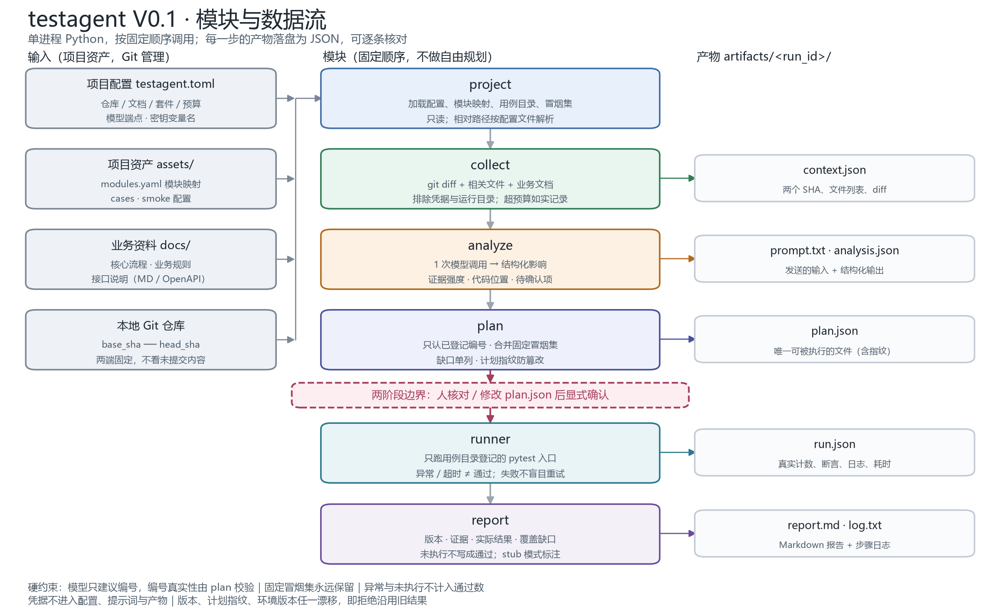
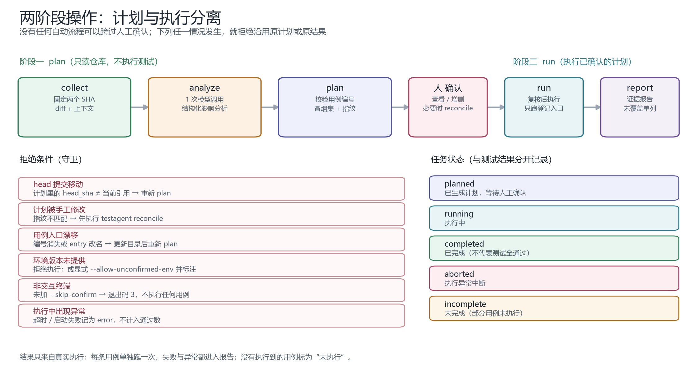
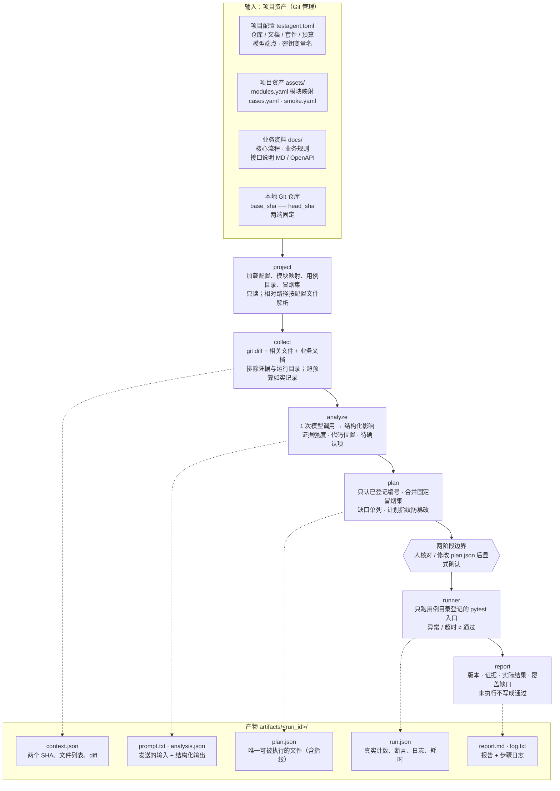
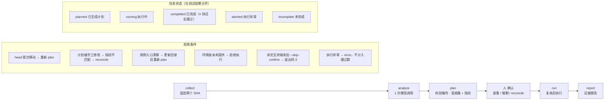

# 架构图





两张图由 `make_diagrams.py` 生成（matplotlib + 微软雅黑），改结构后重跑即可：

```powershell
uv run --with matplotlib python docs/regression/make_diagrams.py
```

## 模块与数据流（Mermaid 源码）

程序位于 `src/api_test_agent/regression/`，提示词位于其中的 `prompts/`；测试在 `tests/regression/`，示例资产在 `examples/regression/`。两个模块共用被忽略的 `subjects/FinUnityServer` 源码克隆，探索模块固定在 55cf875，回归模块按 base/head 采集。命令入口保留 `uv run testpilot`；本次合并验收只用 `plan --stub`，不调用模型。



## 两阶段与守卫（Mermaid 源码）



## 读图要点

1. **一条竖线就是执行顺序**：`project → collect → analyze → plan →（人）→ runner → report`，没有分支、没有循环，也没有让模型自己决定下一步。
2. **每步右侧的产物是契约**：模块之间只通过结构化对象与文件引用交接，`plan.json` 是唯一可被执行的文件。
3. **粉色虚线是唯一的跨界点**：`plan` 之前不执行任何测试，`runner` 之前必须有人确认。
4. **灰色产物框说明证据链**：`context.json` 记录两个 SHA 与 diff，`run.json` 记录真实执行，`report.md` 只能从这两处取数。
